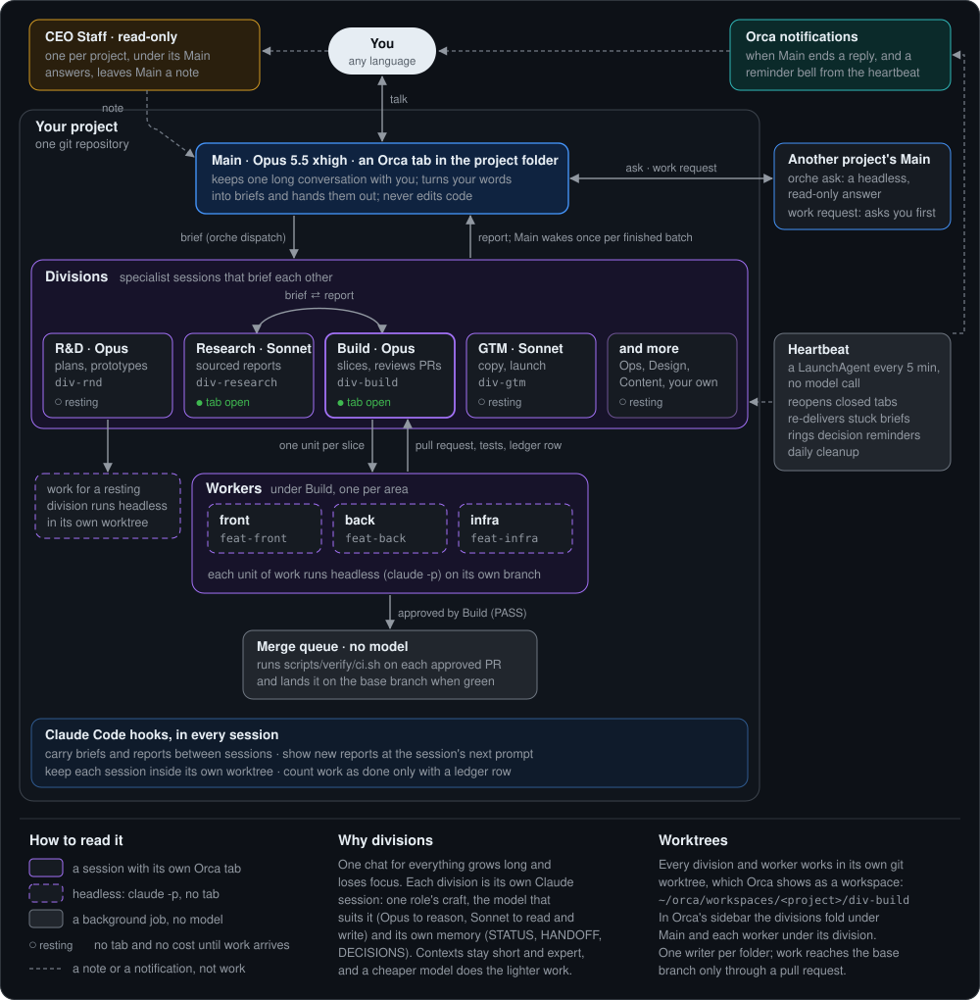

# Orche

Orca + orchestra: a pod of agents working as one, inside the Orca terminal app.

Orche runs a small team of Claude Code sessions on each of your git projects. You talk to one of them, **Main**, in plain words and in any language; the others plan, build, review and land the work.
For developers on macOS who want several agents on one repository without watching each one. Orche is a Claude Code plugin plus an `orche` command.

## What's new

<!-- whats-new: scripts/release.py keeps the three newest -->
- **0.21.4** (2026-11-13): the status line gauges are split in seven, with a thinner pace marker. [Notes](https://github.com/0xMoomi/orche/releases/tag/v0.21.4)
- **0.21.3** (2026-11-13): the status line gauges are split in three. [Notes](https://github.com/0xMoomi/orche/releases/tag/v0.21.3)
- **0.21.2** (2026-11-13): a task Main stopped or closed no longer shows as waiting for the owner. [Notes](https://github.com/0xMoomi/orche/releases/tag/v0.21.2)
<!-- /whats-new -->

Every version: [releases](https://github.com/0xMoomi/orche/releases) and [CHANGELOG.md](CHANGELOG.md).

## How it works



- **Main**, one per project, turns what you say into briefs and hands them to divisions with `orche dispatch`. It also talks to other projects' Mains: `orche ask` gets a read-only answer without waking them, and a work request goes to that Main, which asks you before taking it on.
- **Divisions** (Build, Research, R&D, GTM, Ops, or your own) are specialists: each is its own Claude session with one role's craft, the model that suits it and its own memory, so every context stays short. They brief each other too (Research can hand Build a task), and every report goes back to whoever sent the brief. A resting division has no tab and costs nothing; work sent to it runs headless in its worktree.
- **Worktrees.** Every division and worker works in its own git worktree, which Orca shows as a workspace. In Orca's sidebar the divisions fold under Main's row and each worker under its division: fold them away and open them only when you want to look.
- **Workers** carry out one slice each, headless (`claude -p`, no tab), and open their own pull requests. Build reviews each one, and the merge queue runs `scripts/verify/ci.sh` on the base branch and lands it when green. While a worker runs, `orche status` shows its elapsed time, turn, last tool and cost so far. In team mode (a repository that declares its team plugin) push, pull request and merge wait for your word; in an issue-tracked project (Linear) each worker's name carries the issue key and its PR says `Fixes DES-57`.
- **One report per request.** While work runs, Main adds one status line per step and asks a decision only once. When the last piece has ended you get one final report that stands on its own: the result, each piece of work with its PR, what failed, what you need to decide. Say "the last report again" to get it again.
- **No typing into your panes.** Orche wakes a pane through a file that the pane's own hook watches, so text you left in the input box is never touched, and a busy pane gets new reports at its next tool step.
- **The CEO Staff**, one per project, opens by default in its own workspace under that project's Main, with `STAFF` at the start of its status line. It knows what you said to that Main and what it answered, and answers everyday questions. Ask it for a small task (a look-up, a draft, a status check): it says the task is handed over, and the result arrives in the Staff window by itself. Work only Main can do (a code change, a division, a merge) goes to Main through Staff, and Main's answer comes back to Staff, so you never carry messages between windows. Staff itself changes nothing in your project; the work only Main can do still runs in Main's window, quietly (no alert, no unread mark).
- **The heartbeat**, a LaunchAgent pass every 5 minutes that makes no model call itself, reopens closed panes (also a Main that Orca reopened without Orche), re-delivers stuck briefs, notices a worker that has gone silent, rings reminders and keeps the merge queue moving.
- **The daily brief.** Once a day, after quiet hours, Main opens with what landed, what failed, what has waited for you and for how long, and yesterday's spend. A quiet project gets none.

## Quick start

Needs macOS, Claude Code, Orca, git and Python 3.11+ (the installer checks them and stops with a hint when one is missing). Open Claude Code inside the project you want to set up, and paste:

```text
Install Orche on this Mac and set it up on my project. Run: curl -fsSL https://raw.githubusercontent.com/0xMoomi/orche/main/install.sh | bash -s -- --yes
Then follow the "Next" lines it prints: ask me the setup questions with the choice dialog, in my language, and run the commands yourself.
Stop at the first failure and show me its text; no sudo, no workarounds, never print a key.
```

Then restart Claude Code once so the plugin loads. Already installed? Inside a project, say "set up Orche here", in any language.
Re-running it on a Mac that already has Orche keeps that install (its folder and its plugin or settings mode) and only sets up the project.

**One-time macOS step.** When a project lives in Documents, Desktop, Downloads, iCloud Drive or `/Volumes`, the heartbeat needs Full Disk Access. The installer opens System Settings at the Python app; switch it on under Privacy & Security, Full Disk Access, then run `orche install --grant`.

## What you get

- A `main-<project>` tab in Orca with the project's Staff (`staff-<project>`) in its own workspace under it. Divisions stay dormant (no pane, no cost) until work arrives.
- A first message from Main: the install banner, how Orche works, what was made and what you can switch on any time (also in `<project>/.orche/SETUP.md`).
- Nothing committed to your repository: the project's Orche files (`.orche/`, `PROJECT_CARD.md`, `AGENTS.md`) stay untracked.
- A status line in Main's pane, in your language (English or Korean) and in colour: what waits on you and what runs first, then each division's running/assigned workers and today's spend (`⚠ waiting 2 · ▶ running 3 (oldest 22m/30m) · BUILD 3/8 · … · $4.20 today`), with `⚠ stalled 1` when a worker has printed nothing for 10 minutes.
- Orche's own status line: your branch, the model and its effort, your plan usage (session and weekly, with when each resets), then the project line above. If you already have a status line, Orche keeps it and adds only the project line under it, and Main asks you once at setup which one you want. Orche never edits your status line file.
- Notifications: Orca shows one when Main ends a reply, and Orche rings Main's tab when a decision still waits after 30 minutes; Orca shows that ring as its own notification when its Terminal Bell notifications are on (Settings > Notifications > Terminal Bell; `orche doctor` says if they are off). Missed one? Main's workspace stays marked unread in Orca's sidebar after every turn Orche started there, until you open it.
- Files: the install in `~/orche`, config, registry and logs in `~/.claude/orche`, units and briefs in `<project>/.orche`, the heartbeat in `~/Library/LaunchAgents/com.orche.reconcile.plist`.
- Spend per day: every division is a Claude Code session on your own plan; `orche status` shows each project's spend today, `orche metrics` the detail.

## Any time

Say it to Main in your own words; Main runs the command.

| Say | What happens |
|---|---|
| "turn on Jev" | faster routing of simple requests: `orche jev setup` asks for the key |
| "cross-check PR 12 with Codex" | `orche review --pr 12 --codex`: Codex and Claude read the diff at once; without `--codex` a review is Claude only |
| "set the token for background runs" | you run `claude setup-token`; Main stores it with `orche auth set` |
| "let the janitor clean up" | on by default (the heartbeat runs it daily); this turns it back on after `orche janitor disable` |
| "set up the merge queue for <project>" | `orche init --refresh <project>` opens one PR adding `scripts/verify/ci.sh`; merging it turns the queue on |
| "run up to 30 agents" | `orche hr scale 30`; on a Claude subscription Orche waits for the usage window to reset |
| "add a design division", "switch research to Sonnet", "set up again" | a choice dialog, then `orche hr add`, `orche hr model` or `orche init --refresh` |
| "push DES-57", "merge PR 12" (team mode) | `orche queue add <unit>` pushes and opens the PR; `orche queue approve <project> #12` lands it |
| "update" | `orche update`: the newest Orche, reinstalled, every project's Orche files refreshed (never yours) |
| "what changed in <project>?" | `orche card <project>`, then `orche ask <project> "…"` |
| "how much did this cost?" | `orche metrics`: spend by role (Main, each division, workers, Staff) and how much went to re-runs, by cause |
| "the last report again" | Main writes the final report of the newest finished request again |
| "stop the morning brief", "start it again" | `orche flow brief off` / `orche flow brief on` |
| "run Main on Fable", "put Main back on Opus" | `orche hr model <project> main fable --effort high`: the model Main's pane starts on, from its next start. Fable 5.2 costs twice Opus 5.5 per token, so try it on one project and compare the Rework block of `orche metrics` |
| "which open PRs touch the payment page?" (said to Staff) | Staff hands it to a background errand (`orche errand`) and the answer arrives in the Staff window by itself; work only Main can do goes to Main (`orche errand --main`) and Main's answer comes back to Staff |
| "close the staff window", "open the staff window" | `orche sleep staff-<project>` keeps that project's Staff closed until you ask again; `orche wake staff-<project>` opens it |
| "use Orche's status line", "keep my status line", "turn the status line off" | `orche install --statusline orche`, `keep` or `off`: Orche's line, yours with the project line under it, or yours alone |
| "check the setup", "what else can Orche do?" | `orche doctor`, ending with the next steps |
| "continue" | after a cut-off or /clear, Main picks the work up from `orche status <project>` |
| "uninstall Orche" | `orche uninstall`, after one confirmation: every setting the install changed is restored |

Every action is also an `orche` command, for scripts (`orche --help`). Models, team mode and empty folders: [docs/faq.md](docs/faq.md).

## Docs

- [docs/faq.md](docs/faq.md): short answers, models per division, team mode, empty folders
- [docs/spec.md](docs/spec.md): the full rules (hooks, runs, reconcile, everything internal)
- [docs/glossary.md](docs/glossary.md) · [docs/principles.md](docs/principles.md) · [docs/orca-sidebar.md](docs/orca-sidebar.md) · [CHANGELOG.md](CHANGELOG.md) · [CONTRIBUTING.md](CONTRIBUTING.md) · [SECURITY.md](SECURITY.md) · [LICENSE](LICENSE) (MIT)

Several conventions are adapted from Cursor's **pstack** plugin (MIT, by Lauren Tan); see docs/spec.md.
